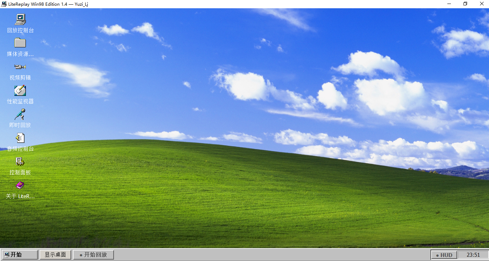
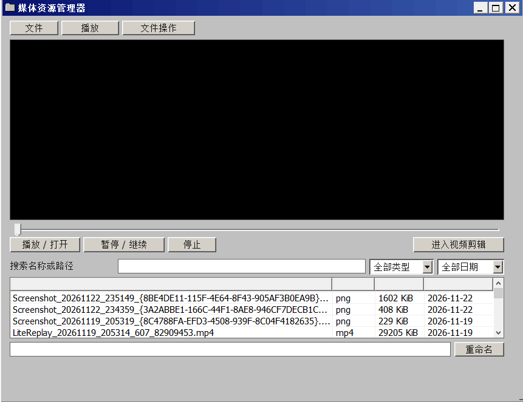
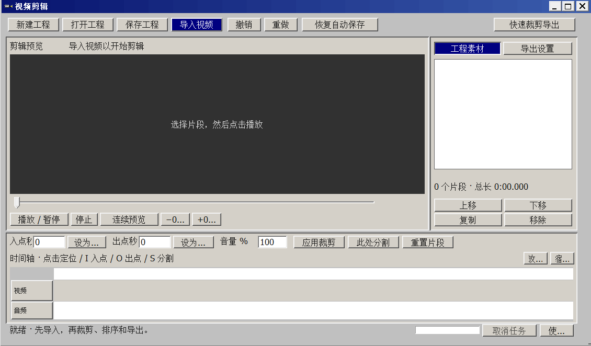
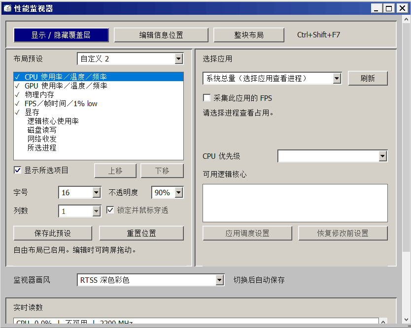
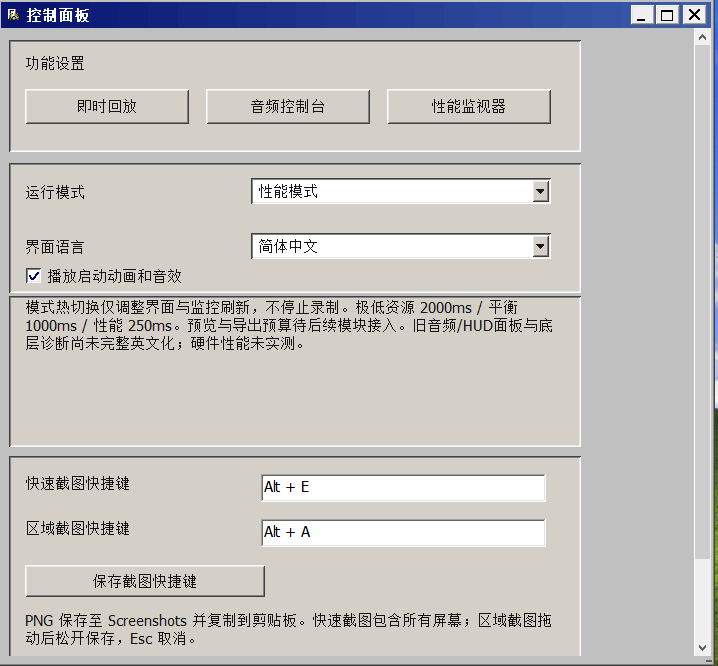
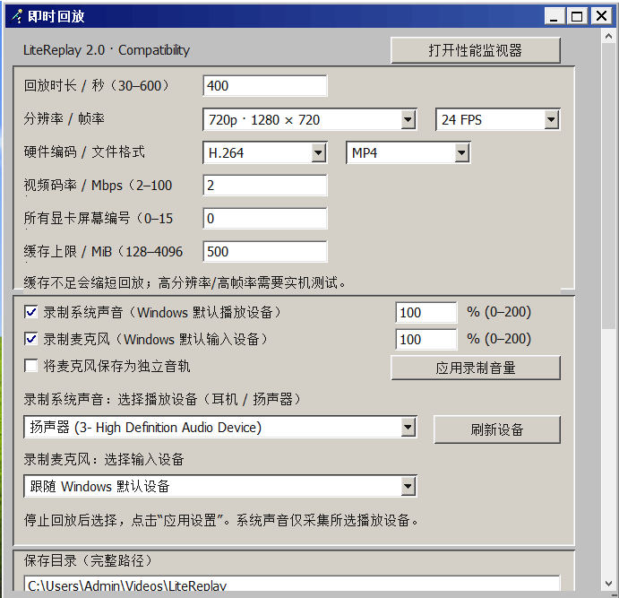
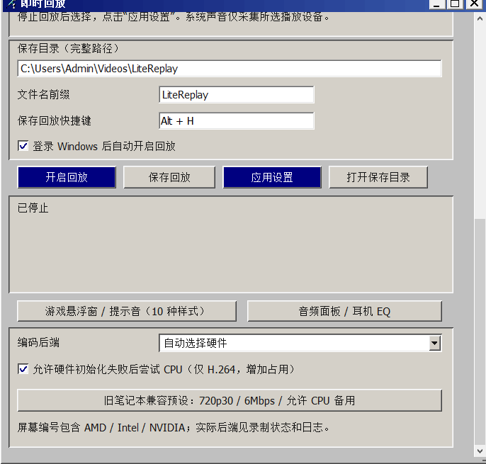
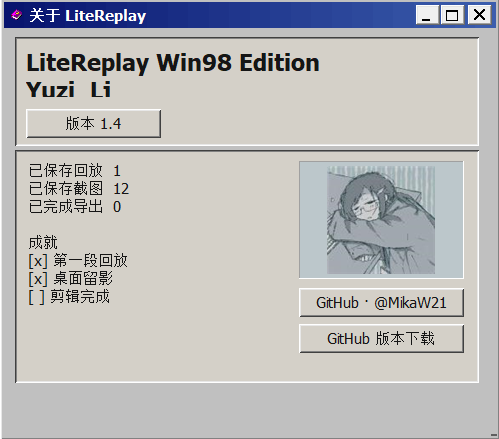

# LiteReplay GameBox 98

复古桌面风格的 Windows 游戏回放工具，由 Yuzi_Lj 制作。GameBox 98 从 LiteReplay Retro Edition 派生，在这个仓库独立维护 1.0–1.4 的开发版本。

## 功能

- **即时回放**：保留最近一段画面，通过快捷键保存。可分别选择系统音频和麦克风设备。
- **媒体库与剪辑**：搜索、筛选和预览回放，直接送入剪辑器裁剪、分割和导出。
- **游戏性能监视**：查看 CPU、GPU、内存和帧率等指标，调整游戏覆盖层布局。
- **截图与复古桌面**：支持全屏和框选截图、开始菜单、任务栏，以及可关闭的启动动画与音效。

## 版本与运行

建议从 1.4 开始。可通过仓库的 **Code → Download ZIP** 下载完整目录。解压后进入版本的 `bin/windows-x64`，运行 `LiteReplay-Win98.exe`。启动前先从系统托盘退出正在运行的 LiteReplay。

| 版本 | 文件夹 | 主要变化 |
| --- | --- | --- |
| **1.4** | [LiteReplay-Win98-Edition-1.4](versions/LiteReplay-Win98-Edition-1.4) | GitHub 头像、个人主页与下载入口，统一程序与托盘图标 |
| 1.3 | [LiteReplay-Win98-Edition-1.3](versions/LiteReplay-Win98-Edition-1.3) | 云天启动动画、启动音效、窄任务栏图标与悬停提示 |
| 1.2 | [LiteReplay-Win98-Edition-1.2](versions/LiteReplay-Win98-Edition-1.2) | 重做媒体库与剪辑工作区，加入可关闭的启动动画 |
| 1.1 | [LiteReplay-Win98-Edition-1.1](versions/LiteReplay-Win98-Edition-1.1) | 首轮 UI 改版的独立版本目录 |
| 1.0 | [LiteReplay-Win98-Edition](versions/LiteReplay-Win98-Edition) | 未编号的早期工作目录，包含后来写入该目录的 UI 预览 |

运行包面向 Windows x64。Win98 指界面风格，各版本的依赖、构建方式和第三方说明见对应目录。

## 软件截图

| 媒体资源管理器 | 视频剪辑 |
| --- | --- |
|  |  |
| **性能监视器** | **控制面板** |
|  |  |
| **即时回放与音频设备** | **保存、快捷键与编码设置** |
|  |  |
| **关于窗口** | |
|  | |

作者：[Yuzi_Lj / MikaW21](https://github.com/MikaW21)。
